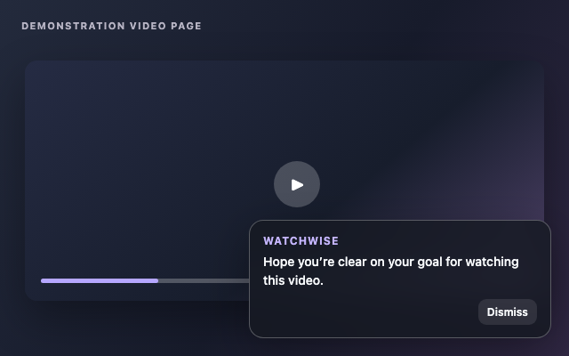

# Watchwise


**Watch with intent.** Watchwise is a Chrome extension that shows where your video time goes and gives you a gentle moment to decide whether to stay. One extension is all you need; there is no Mac app or companion service.

[Try Watchwise](#try-watchwise) · [Suggest a feature](https://github.com/amolsharma99/Watchwise/issues/new?template=feature_request.yml) · [Contribute](CONTRIBUTING.md) · [Report a bug](https://github.com/amolsharma99/Watchwise/issues/new)

> **Release status:** The submitted Chrome Web Store package is local-only v0.4.0. The newer v0.4.1 source and experimental v0.3.16 build have additional Studio features; neither is the submitted package. This repository does not yet include a verified public Store install link.

## Try Watchwise

1. In Chrome, open `chrome://extensions`, turn on **Developer mode**, and choose **Load unpacked**.
2. Select [`ChromeExtension/store-local`](ChromeExtension/store-local) for the local-only source build. Click Watchwise's toolbar icon to open the side panel.
3. Read the site-access disclosure, then choose whether to turn on local tracking and in-page alerts. Watch an ordinary video in the active Chrome window to see your insights grow.

This source folder is the **unsubmitted v0.4.1 candidate**. The [Store user guide](store/USER_GUIDE.md) and [Store privacy policy](store/PRIVACY.md) describe the submitted v0.4.0 package. See [which build is which](#which-build-is-which) before trying the experimental Gemini API version.

## See your time clearly

Watchwise counts **active watching**, not merely an open video tab. It records eligible HTML5 playback while the video is visible in Chrome's active tab and window. A video counts as **started** after three seconds of real playback progress, so loading a player or jumping ahead does not inflate the number.

The side panel gives you today's time and starts, a weekly snapshot, **Top sites**, and a **Video breakdown** sorted by minutes watched. Each video row includes its title, site, and a link when the website provides them.

*Screenshots below are synthetic demo captures of the submitted v0.4.0 interface. They use its earlier purple palette; the v0.4.1 source has the ink and caramel design shown in the icon above.*


## A nudge at the right moment

After about 15 seconds of actual playback, Watchwise can place a small translucent check-in on the video page. It asks you to remember why you pressed play. The message can vary with the site, video title, and recent viewing pattern; a seek jump itself does not count toward the timer. The goal check-in appears at most once for the same video in 24 hours, with a gap between interruptions.

Here are three messages the extension can show:

| Moment | What Watchwise says |
| --- | --- |
| General check-in | “This video has a retention strategy. Do you have an exit strategy? 👀” |
| Tutorial-style title | “Your question matters more than the intro. If this isn't helping, please move on. ✨” |
| Streaming site | “Plot twist: you can leave before the outro. 🎬” |

Long sessions, several videos in a row, and reaching your daily viewing target can trigger other gentle reminders. Watchwise keeps these messages inside the page; it does not send Chrome or macOS notification banners.



## Make room for uninterrupted watching

You control when Watchwise speaks up. **Movie Mode** quiets nudges for two hours; **Snooze** does so for 30 minutes. You can set quiet hours, switch in-page alerts off, or exclude a site. A daily viewing target guides longer-session nudges. Movie Mode keeps local time tracking on, so a film still appears in your insights.


## Keep your history yours

The local-only builds start with tracking **off**. After you opt in, they keep eligible video URLs, title metadata, playback events, and settings in encrypted local storage in your Chrome profile. They have no Watchwise account, developer analytics service, ads, or remote AI request. You can export your history as JSON, delete it, or turn tracking off. Exported JSON is plaintext, so store the downloaded file privately. Playback events older than 180 days are removed automatically.


Watchwise requests access to HTTPS sites so it can detect videos across websites and embedded frames. It does not record screen pixels, audio, captions, forms, passwords, cookies, or arbitrary page text. Read the [submitted Store package's privacy policy](store/PRIVACY.md) for the precise data and security boundaries.

## Which build is which

- **Submitted Store package, v0.4.0:** local tracking, insights, nudges, and quiet controls. No Gemini API or AI Studio shortcut. Its history and settings are encrypted in local IndexedDB.
- **Current local-only source, v0.4.1 candidate:** the same core features and storage, plus **Ask in AI Studio** on standard YouTube watch pages. Clicking copies `Summarise the video with topics and bullets for each - {url}` and opens Studio. You choose whether to paste and send it. Watchwise does not receive the answer. This candidate has not been uploaded to the Store.
- **Experimental unpacked build, v0.3.16:** **Summarise in Gemini AI Studio** prepares that prompt in Studio for you to review and send. Separately, optional automatic Gemini API analysis uses your own key and explicit consent and may consume paid quota. This build uses Chrome extension local storage and is not the Store submission.

The Studio shortcuts appear on standard YouTube watch videos, excluding Shorts, feeds, and embeds. Neither shortcut requires an API key in Watchwise, and Studio's response stays in Studio.

The experimental build's API analysis starts asynchronously after meaningful playback on a public YouTube watch video when its AI consent and automatic-analysis switches are on. The latest status or result appears under **Settings → Latest Gemini API analysis**. There is no separate Analyse tab. Its AI-generated summary, possible skips, and information-value verdict are suggestions, not independent fact checks. When analysis supplies validated evidence of a low-information section, a nudge may suggest a skip or a comfortable 1.25× playback pace. Both builds keep the AI Studio action separate from API analysis; the Studio action does not require an API key in Watchwise.

The local-only source is in [`ChromeExtension/store-local`](ChromeExtension/store-local); the experimental source is in [`ChromeExtension`](ChromeExtension). The local-only build makes no remote model requests. See the experimental build's [setup and update notes](ChromeExtension/README.md) and [privacy policy](PRIVACY.md).

## Install and compatibility

When a verified Store listing is available, install it from there and open Watchwise from the toolbar. To try the experimental build from source, load [`ChromeExtension`](ChromeExtension) in Developer mode. If you switch builds, disable the other copy to avoid duplicate nudges; each has separate history.

Chrome 116 or later is required. Tracking works with detectable HTML5 video on HTTPS websites, including supported YouTube pages, Netflix, and other sites with accessible players. DRM, canvas, custom, or inaccessible embedded players may not be counted. Titles can be generic when a site does not expose reliable metadata. Watchwise favors an honest gap over guessing from unrelated page text.

## Ideas and collaboration

Watchwise is still growing. If a video habit, website, insight, or nudge could work better, [suggest a feature](https://github.com/amolsharma99/Watchwise/issues/new?template=feature_request.yml). Tell us the viewing problem, what you hoped Watchwise would do, and a public or synthetic example if it helps. For something broken, [open a bug report](https://github.com/amolsharma99/Watchwise/issues/new). Please remove private video URLs, viewing history, and API keys from issues and screenshots.

Want to help build it? Read [CONTRIBUTING.md](CONTRIBUTING.md) and open an issue before a larger change so the behavior and edition are clear. GitHub Issues is our shared place for requests and collaboration.

## Build and verify

On macOS, from the repository root, the local-only package checks are:

```sh
ruby ChromeExtension/tests/local_store_check.rb
ruby ChromeExtension/tests/run_local_store_jsc.rb
ruby ChromeExtension/tests/run_local_store_chrome.rb
```

For the experimental build on macOS:

```sh
/System/Library/Frameworks/JavaScriptCore.framework/Versions/A/Helpers/jsc -m ChromeExtension/tests/run.mjs
ruby ChromeExtension/tests/integration_check.rb
ruby ChromeExtension/tests/run_studio_handoff_jsc.rb
```

See [Chrome architecture](CHROME_ARCHITECTURE.md), [security notes](SECURITY.md), and the [release plan](RELEASE_PLAN.md) for implementation and publication details. The older Swift Mac app and browser bridge remain in the repository as legacy source; neither is needed for the Chrome extension.

<sub>Screenshots show synthetic viewing data, not a person's history or a live AI result.</sub>
