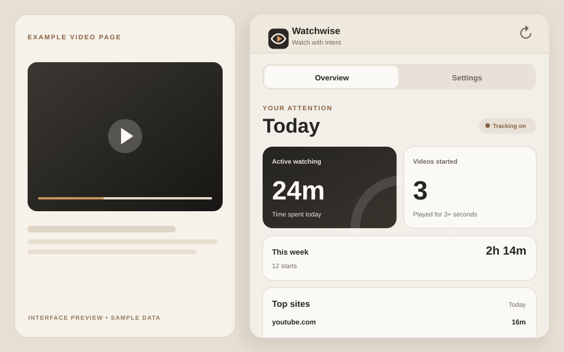
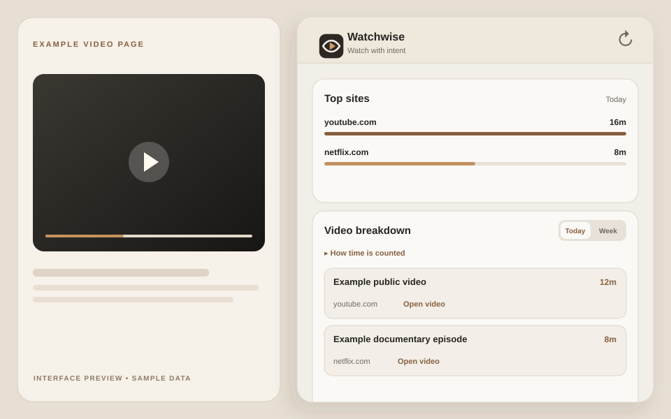
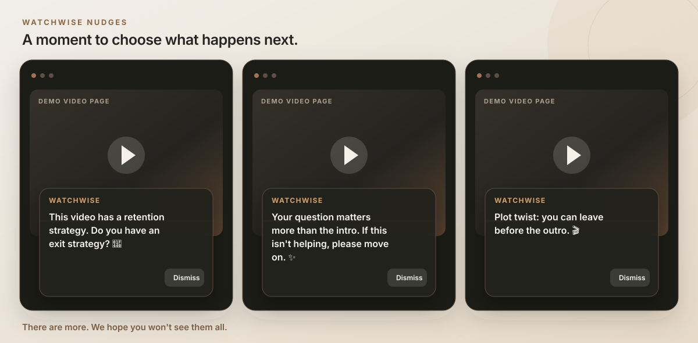
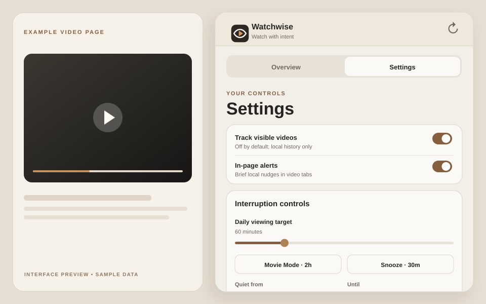
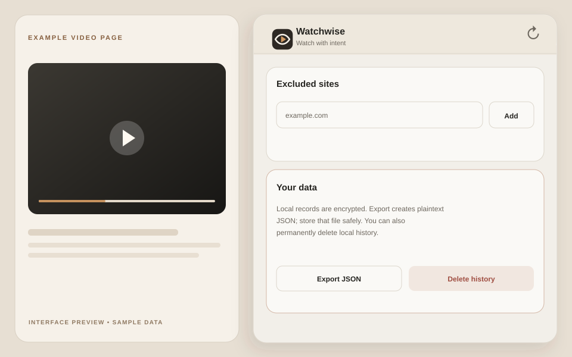

# Watchwise


**Watch with intent.** Watchwise helps you see where your video time goes and gives you a gentle moment to decide whether to stay. It runs entirely as a Chrome extension, with no Mac app or companion service.

[Try Watchwise](#try-watchwise) · [Suggest a feature](https://github.com/amolsharma99/Watchwise/issues/new?template=feature_request.yml) · [Contribute](CONTRIBUTING.md) · [Report a bug](https://github.com/amolsharma99/Watchwise/issues/new?template=bug_report.yml)

> **Latest source: v0.4.2.** You can install it locally now. A verified public install link will be added when available.

## Try Watchwise

1. [Download the source ZIP](https://github.com/amolsharma99/Watchwise/archive/refs/heads/main.zip) and unzip it, or clone the repository with `git clone https://github.com/amolsharma99/Watchwise.git`.
2. Open `chrome://extensions` in Chrome, turn on **Developer mode**, and choose **Load unpacked**.
3. Select the downloaded [`ChromeExtension/store-local`](ChromeExtension/store-local) folder. Click the Watchwise toolbar icon to open the side panel.
4. Read the site-access disclosure, then choose whether to turn on tracking and in-page alerts. Play a video in the active Chrome window to see your insights grow.

## See your time clearly

Watchwise counts **active watching** while an eligible video is visibly playing in Chrome's active tab and window. A video counts as **started** after three seconds of real playback progress. Loading a player or jumping ahead does not inflate the number.

The side panel shows today's time and starts, a weekly snapshot, and **Top sites**. **Video breakdown** puts the videos that used the most time first, with a title, site, and link when the website provides them. Switch between Today and Week to spot patterns.





## A nudge at the right moment

After about 15 seconds of actual playback, Watchwise can place a small translucent check-in on the page. It asks you to remember why you pressed play. The wording can change with the site, video title, and recent viewing pattern. A seek jump does not count toward the timer, and the goal check-in appears at most once for the same video in 24 hours, with a gap between interruptions.



**In the wild:**

[](docs/readme/real-nudge-example.png)

Long sessions, several videos in a row, and reaching your daily viewing target can prompt other reminders. Watchwise keeps them inside the page; it does not send Chrome or macOS notification banners.

## Quiet when you want it

**Movie Mode** quiets nudges for two hours. **Snooze** does so for 30 minutes. You can also set quiet hours, turn in-page alerts off, or exclude a site. Your daily viewing target guides longer-session nudges. Movie Mode keeps local time tracking on, so a film still appears in your insights.



## Your history stays yours

Tracking starts **off**. When you opt in, Watchwise keeps eligible video URLs, title metadata, playback events, and settings in encrypted local storage in your Chrome profile. There is no Watchwise account, developer analytics service, or advertising. You can export history as JSON, delete it, or stop tracking. Exported JSON is plaintext, so keep the downloaded file private. Playback events older than 180 days are removed automatically.



Watchwise requests HTTPS site access to detect videos across websites and embedded frames. It does not record screen pixels, audio, captions, forms, passwords, cookies, or arbitrary page text. The [Store privacy policy](store/PRIVACY.md) describes the package submitted for review.

## Where it works

Chrome 116 or later is required. Watchwise works with detectable HTML5 video on HTTPS websites, including supported YouTube pages, Netflix, and other sites with accessible players. DRM, canvas, custom, or inaccessible embedded players may not be counted. A title can be generic when a site does not expose reliable metadata; Watchwise does not guess one from unrelated page text.

If you later install the Store edition or try the experimental build, disable your other Watchwise copy to avoid duplicate nudges. Each installation keeps its own history.

## Ideas and collaboration

What would help you watch more intentionally? [Suggest a feature](https://github.com/amolsharma99/Watchwise/issues/new?template=feature_request.yml) with the viewing problem, what you hoped Watchwise would do, and a public or synthetic example if one helps. [Report a bug](https://github.com/amolsharma99/Watchwise/issues/new?template=bug_report.yml) if something is broken. Please remove private video URLs, viewing history, and API keys from issues and screenshots.

Want to help build it? Read [CONTRIBUTING.md](CONTRIBUTING.md) and open an issue before a larger change. GitHub Issues is our shared place for requests and collaboration.

## Build and verify

On macOS, from the repository root, run the local-only checks:

```sh
ruby ChromeExtension/tests/local_store_check.rb
ruby ChromeExtension/tests/run_local_store_jsc.rb
ruby ChromeExtension/tests/run_local_store_chrome.rb
```

For the experimental build:

```sh
/System/Library/Frameworks/JavaScriptCore.framework/Versions/A/Helpers/jsc -m ChromeExtension/tests/run.mjs
ruby ChromeExtension/tests/integration_check.rb
```

See [Chrome architecture](CHROME_ARCHITECTURE.md), [security notes](SECURITY.md), and the [release plan](RELEASE_PLAN.md) for implementation and publication details. The older Swift Mac app and browser bridge remain as legacy source; neither is needed for the Chrome extension.
