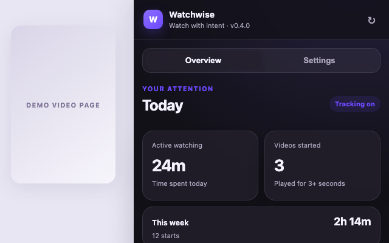
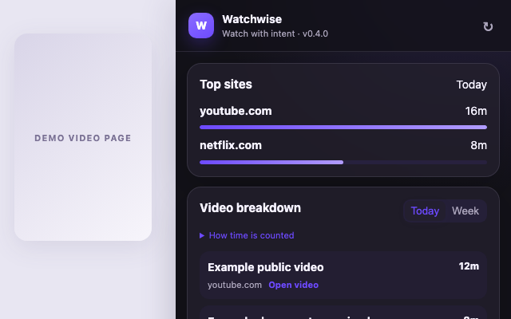
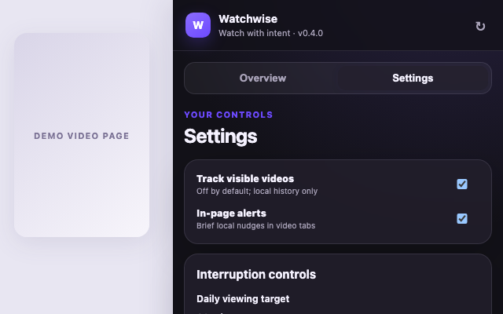
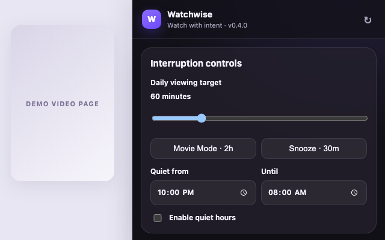
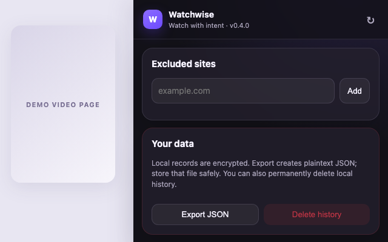

# Watchwise


**Watch with intent.** Watchwise is a Chrome extension that shows where your video time goes and gives you a gentle moment to decide whether to stay. One extension is all you need; there is no Mac app or companion service.

[See the user guide](store/USER_GUIDE.md) · [Read the privacy policy](store/PRIVACY.md) · [Report an issue](https://github.com/amolsharma99/Watchwise/issues)

> **Release status:** This repository does not yet include a verified public Chrome Web Store install link. The source also contains a separate experimental build with optional Gemini features; [see the edition guide](#two-editions-one-purpose) before loading either one.

## See your time clearly

Watchwise counts **active watching**, not merely an open video tab. It records eligible HTML5 playback while the video is visible in Chrome's active tab and window. A video counts as **started** after three seconds of real playback progress, so loading a player or jumping ahead does not inflate the number.

The side panel gives you today's time and starts, a weekly snapshot, **Top sites**, and a **Video breakdown** sorted by minutes watched. Each video row includes its title, site, and a link when the website provides them.





## A nudge at the right moment

After about 15 seconds of actual playback, Watchwise can place a small translucent check-in on the video page. It asks you to remember why you pressed play. The message can vary with the site, video title, and recent viewing pattern; a seek jump itself does not count toward the timer. The goal check-in appears at most once for the same video in 24 hours, with a gap between interruptions.

Here are three messages the extension can show:

| Moment | What Watchwise says |
| --- | --- |
| A video is keeping you around | “This video has a retention strategy. Do you have an exit strategy? 👀” |
| A tutorial is taking its time | “Your question matters more than the intro. If this isn't helping, please move on. ✨” |
| You are watching a streaming title | “Plot twist: you can leave before the outro. 🎬” |

Long sessions, several videos in a row, and reaching your daily viewing target can trigger other gentle reminders. Watchwise keeps these messages inside the page; it does not send Chrome or macOS notification banners.


## Make room for uninterrupted watching

You control when Watchwise speaks up. **Movie Mode** quiets nudges for two hours; **Snooze** does so for 30 minutes. You can set quiet hours, switch in-page alerts off, or exclude a site. A daily viewing target guides longer-session nudges. Movie Mode keeps local time tracking on, so a film still appears in your insights.





## Keep your history yours

The public edition starts with tracking **off**. After you opt in, it keeps eligible video URLs, title metadata, playback events, and settings in encrypted local storage in your Chrome profile. It has no Watchwise account, developer analytics service, ads, or remote AI request. You can export your history as JSON, delete it, or turn tracking off. Exported JSON is plaintext, so store the downloaded file privately. Playback events older than 180 days are removed automatically.



Watchwise requests access to HTTPS sites so it can detect videos across websites and embedded frames. It does not record screen pixels, audio, captions, forms, passwords, cookies, or arbitrary page text. Read the [Store edition privacy policy](store/PRIVACY.md) for the precise data and security boundaries.

## Two editions, one purpose

| | Public Store edition | Experimental unpacked build |
| --- | --- | --- |
| Viewing insights, nudges, quiet controls | Yes | Yes |
| YouTube Studio shortcut | **Ask in AI Studio** copies a prompt and opens Studio; you choose whether to paste and send it | **Summarise in Gemini AI Studio** opens Studio with the prompt prepared for you to review and send |
| Automatic Gemini API analysis | No | Optional, with your own key and explicit consent; may consume paid quota |
| Storage | Encrypted local IndexedDB | Chrome extension local storage |

The Studio shortcut appears on standard YouTube watch videos, excluding Shorts, feeds, and embeds. It uses the prompt `Summarise the video with topics and bullets for each - {url}`. You review what Studio sends; its response stays in Studio and is not imported into Watchwise.

The experimental build's API analysis starts asynchronously after meaningful playback on a public YouTube watch video when its AI consent and automatic-analysis switches are on. The latest status or result appears under **Settings → Latest Gemini API analysis**. There is no separate Analyse tab. Its AI-generated summary, possible skips, and information-value verdict are suggestions, not independent fact checks. When analysis supplies validated evidence of a low-information section, a nudge may suggest a skip or a comfortable 1.25× playback pace. Both builds keep the AI Studio action separate from API analysis; the Studio action does not require an API key in Watchwise.

The public package is in [`ChromeExtension/store-local`](ChromeExtension/store-local); the experimental source is in [`ChromeExtension`](ChromeExtension). The public edition makes no remote model requests. The experimental build is **not** the Chrome Web Store release. See its [setup and update notes](ChromeExtension/README.md) and [privacy policy](PRIVACY.md).

## Get started

**When the Store listing is live:** install Watchwise from its verified listing, click its toolbar icon, read the site-access disclosure, and choose whether to enable tracking and in-page alerts.

**To try the source now:** open `chrome://extensions`, enable **Developer mode**, choose **Load unpacked**, and select [`ChromeExtension/store-local`](ChromeExtension/store-local) for the local-only edition. Select [`ChromeExtension`](ChromeExtension) only if you want the experimental build. Open the toolbar icon to use the side panel. If you switch editions, disable the other copy to avoid duplicate nudges; each edition keeps separate history.

Chrome 116 or later is required. Tracking works with detectable HTML5 video on HTTPS websites, including supported YouTube pages, Netflix, and other sites with accessible players. DRM, canvas, custom, or inaccessible embedded players may not be counted. Titles can be generic when a site does not expose reliable metadata. Watchwise favors an honest gap over guessing from unrelated page text.

## Build and verify

From the repository root, the public package checks are:

```sh
ruby ChromeExtension/tests/local_store_check.rb
ruby ChromeExtension/tests/run_local_store_jsc.rb
ruby ChromeExtension/tests/run_local_store_chrome.rb
```

For the experimental build:

```sh
/System/Library/Frameworks/JavaScriptCore.framework/Versions/A/Helpers/jsc -m ChromeExtension/tests/run.mjs
ruby ChromeExtension/tests/integration_check.rb
ruby ChromeExtension/tests/run_studio_handoff_jsc.rb
```

See [Chrome architecture](CHROME_ARCHITECTURE.md), [security notes](SECURITY.md), and the [release plan](RELEASE_PLAN.md) for implementation and publication details. The older Swift Mac app and browser bridge remain in the repository as legacy source; neither is needed for the Chrome extension.

<sub>Screenshots use synthetic viewing data from the Store edition's v0.4.0 demo fixtures. They show product flows, not a person's history or a live AI result. The current v0.4.1 interface uses an updated ink and caramel palette.</sub>
