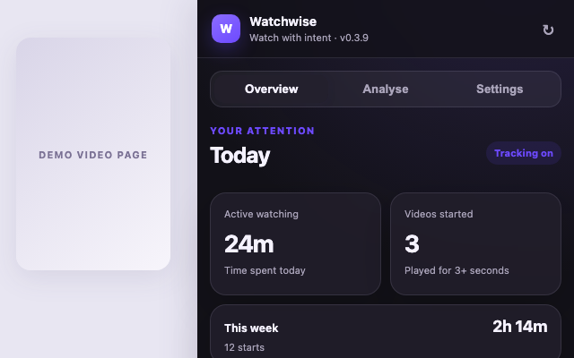
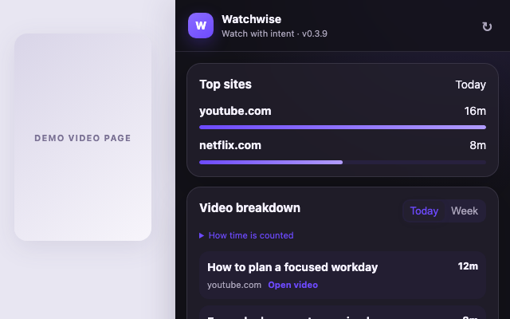
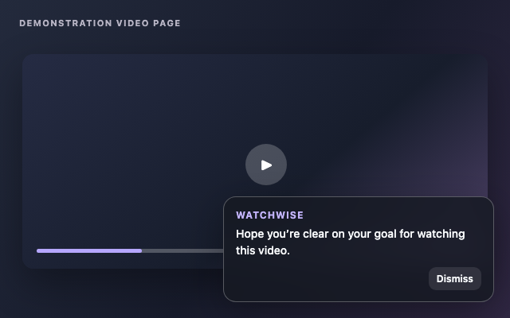
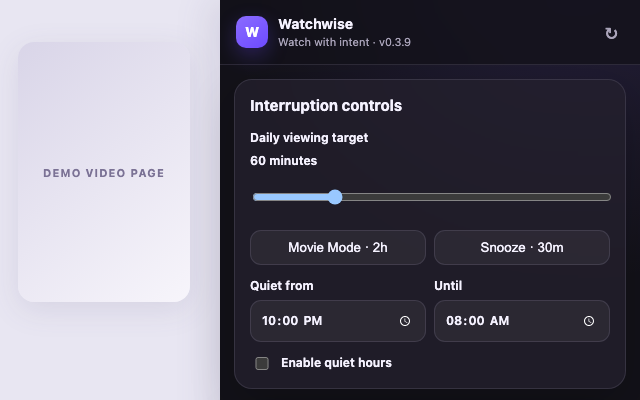
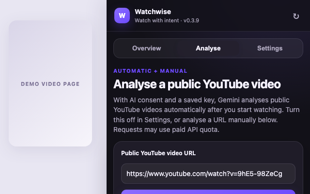
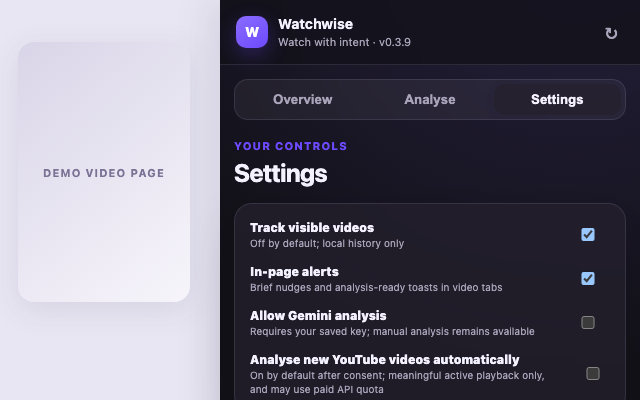

# Watchwise user guide

Watchwise is a Chrome extension for noticing and reducing passive video watching. It runs in Chrome; there is no Mac app or companion program to install. This guide shows the current public-release interface using **demonstration viewing data**, not a real person's history.

## Start here

1. Install Watchwise from the Chrome Web Store once the listing is published, then click its toolbar icon to open the side panel.
2. Read the site-access disclosure. Turn on **Track visible videos** if you want local viewing insights. Tracking starts only after this choice.
3. Turn on **In-page alerts** if you want gentle nudges. They appear inside the video page, not as macOS banners.
4. Watch an ordinary HTML5 video in an active Chrome tab. The Overview fills in as you watch. Pin the toolbar icon if you want quicker access.

## Understand your time

**Active watching** counts time when an eligible video is visibly playing in the active Chrome tab and window. A **video started** count appears only after at least three seconds of real playback progress; a seek jump or a player loading is not a start. Watchwise uses this rule to avoid inflated counts from previews and player replacements.

The Overview shows today's active minutes and starts, a week summary, and **Top sites**. **Video breakdown** lists saved video titles, links, sites, and minutes, longest watched first. Switch its **Today / Week** control to compare periods. If two videos play at once, Watchwise shares overlapping time among them so breakdown rows add up to the overall active time.

Tracking works with detectable HTML5 video on HTTPS websites, including YouTube watch pages and Shorts, Netflix, and other sites that expose a supported player. Some DRM, canvas, custom, or inaccessible embedded players cannot be tracked. YouTube homepage autoplay previews without a canonical video ID are excluded. Titles may be generic when a site does not expose reliable metadata. Watchwise reads a narrow Netflix player-title metadata element on `/watch/` pages when ordinary metadata is generic.

## Get a gentle check-in

With In-page alerts on, Watchwise can show **“Hope you’re clear on your goal for watching this video.”** after about 15 seconds of actual, visible playback. Skipping ahead does not count toward the 15 seconds; watching after the seek does. The check-in is at most once per video identity for 24 hours, with a short gap between nudges. Other nudges can suggest a pause or a useful skip point when Watchwise has enough context.

For uninterrupted watching, use **Movie Mode · 2h**, **Snooze · 30m**, quiet hours, or the In-page alerts switch. You can also exclude specific sites. These controls silence nudges; Movie Mode and exclusions also pause automatic AI analysis. Tracking continues during Movie Mode unless you turn tracking off.

## Analyse a public YouTube video (optional)

Watchwise can ask Google's Gemini API for a quick take, key moments, possible skips, evidence signals, and a cautious information-value verdict. This is **not an external fact-check** and may be wrong or incomplete. The feature supports public YouTube URLs, not Netflix or arbitrary website videos.

To use it, open **Settings**, turn on **Allow Gemini analysis**, and save your own Gemini API key. With both in place, Watchwise automatically starts analysis for a new public YouTube video after meaningful active playback. **Analyse new YouTube videos automatically** is on by default after AI setup; turn it off if you want manual analysis only. In the **Analyse** tab, you can paste a public YouTube URL and choose **Analyse with Gemini**. A request is asynchronous; the result appears in the side panel when ready, and a brief in-page toast can appear in the source tab.

Each new analysis may consume paid Gemini API quota or incur charges on your Google account. A saved key does not guarantee available quota. A private, restricted, unavailable, or unsupported video can fail. If you close the source tab, reopen Watchwise to see the saved result; no macOS banner is sent.

## Control and remove your data

**Settings** holds the tracking and alert switches, automatic analysis, daily target, interruption controls, site exclusions, and Gemini key controls. **Export JSON** downloads your local viewing and analysis records with safe settings; it excludes the API key. Watchwise also prunes playback events and completed analysis records after 180 days. **Delete history** removes local viewing events and analysis records sooner. It does not clear your saved API key or settings, so use **Clear saved key** separately. Turning tracking off stops new records but keeps existing history until deletion or automatic pruning.

The [privacy policy](PRIVACY.md) describes data handling and the optional transfer to Google. Watchwise has no developer-operated analytics server and no account. Its broad HTTPS access is needed to detect eligible video across websites and embedded frames; tracking stays off until you opt in.

## If something looks wrong

- **Time or starts did not change:** Keep Chrome frontmost and the video visible for at least a few seconds of actual playback. Reload an already-open video tab after an extension update. Check that tracking is on and the site is not excluded.
- **No in-page check-in:** Check In-page alerts, Movie Mode, snooze, and quiet hours. Allow about 20–25 seconds after a seek. Fullscreen players that do not render extension overlays may show the check-in only after leaving fullscreen.
- **Gemini is queued or fails:** Open Analyse and refresh after processing. Check the key, AI consent, public URL, connection, and available Gemini API quota. Do not repeatedly submit the same video. Share only Watchwise's safe status text in a support report—never your key or raw request.
- **Title is generic:** The site may not expose reliable metadata. Watchwise avoids guessing from unrelated page text.

For support, open a [Watchwise GitHub issue](https://github.com/amolsharma99/Watchwise/issues) using a public or synthetic video example. Do not attach private viewing history, an API key, or personal browser data.
