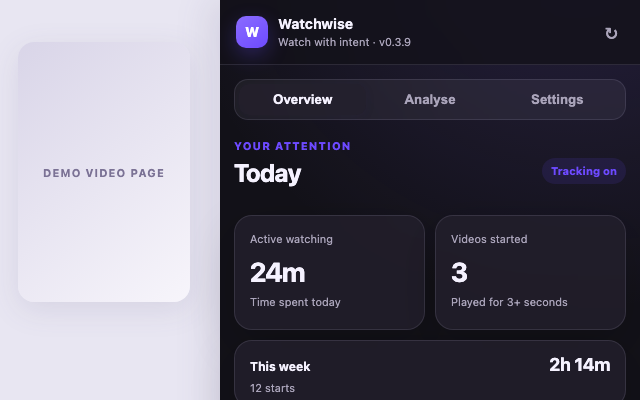
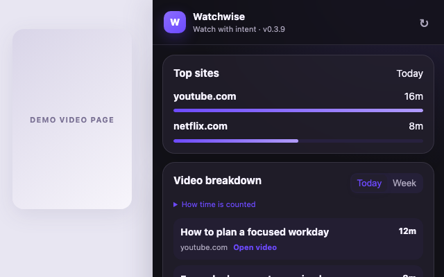
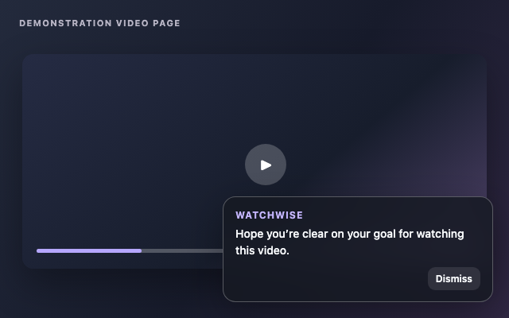
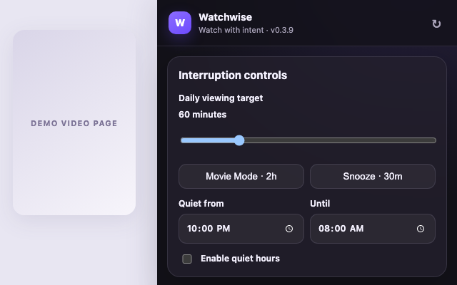

# Watchwise Store edition user guide

Watchwise helps you notice and reduce passive video watching in Chrome. The Store edition is **local-only**: there is no Mac app, Watchwise account, Gemini analysis, or API key. Images below use clearly labelled demonstration data.

## Get started

1. Install Watchwise from the Chrome Web Store once the listing is approved.
2. Click its toolbar icon to open the side panel. Read the HTTPS site-access disclosure.
3. Turn on **Track visible videos** to begin local viewing insights. Tracking is off until you choose this.
4. Turn on **In-page alerts** if you want gentle check-ins. They appear within the video page, not in macOS banners.

If you previously loaded the experimental unpacked Watchwise extension, the Store installation starts with separate, empty local history. Export the unpacked history first if you want a backup, then disable the unpacked copy so you do not see duplicate nudges. There is no import into the Store edition.

## Overview and video breakdown

**Active watching** counts eligible HTML5 video while it plays visibly in the active Chrome tab and window. **Videos started** counts a video after at least three seconds of real playback progress. Seeking ahead, loading metadata, and near-contiguous player replacements do not create extra starts.

The Overview shows today's time and starts plus weekly context. **Top sites** totals time by website. **Video breakdown** lists saved titles, links, sites, and minutes in descending order; its Today/Week control changes the period. Simultaneous viewing time is shared across active videos so rows add up to the overall total.

Watchwise tracks detectable HTML5 video on HTTPS sites, including supported YouTube watch pages and Shorts, Netflix, and other websites with ordinary players. Some DRM, canvas, custom, or inaccessible embedded players may not work. YouTube homepage autoplay previews without a canonical video ID are excluded. If a site supplies only generic metadata, Watchwise may show a generic title rather than guessing from unrelated page text.

## In-page nudges and quiet controls

After about 15 seconds of actual, visible playback, Watchwise can show: **“Hope you’re clear on your goal for watching this video.”** A seek jump itself does not count; continued playback after the seek does. The check-in appears at most once per video identity for 24 hours with a short gap between nudges. Other nudges may suggest a pause when Watchwise detects a longer viewing pattern.

Use **Movie Mode · 2h**, **Snooze · 30m**, quiet hours, site exclusions, or the In-page alerts switch when you want no interruption. Tracking continues in Movie Mode unless you turn tracking off. The daily viewing target controls longer-session nudges.

## Privacy, export, and deletion

Watchwise saves eligible video metadata and playback events in local Chrome IndexedDB; settings stay in extension local storage. It has no developer-operated server, remote AI calls, or analytics. It does not capture screen pixels, audio, captions, forms, cookies, passwords, or arbitrary page text. The exact title metadata of a Netflix `/watch/` player may be read when ordinary title sources are generic. See the [Store edition privacy policy](PRIVACY.md).

Use **Export JSON** to download local history and safe settings. **Delete history** clears local viewing records. Watchwise also removes playback events after 180 days. Turning tracking off stops new records but does not erase older entries immediately.

## Troubleshooting

- If minutes or starts stay unchanged, keep Chrome frontmost and the video visible; watch for at least a few seconds of actual playback. Check tracking and site exclusions. Reload an already-open video tab after an extension update.
- If the goal toast does not appear, check In-page alerts, Movie Mode, snooze, quiet hours, and whether the video has played for 15 real seconds after any seek. Some fullscreen players cannot show an extension overlay until you exit fullscreen.
- If a title is generic, the site may not expose reliable metadata. Watchwise does not infer titles from surrounding page text.

For support, use [Watchwise GitHub issues](https://github.com/amolsharma99/Watchwise/issues) with a public or synthetic example. Do not attach private viewing history.
